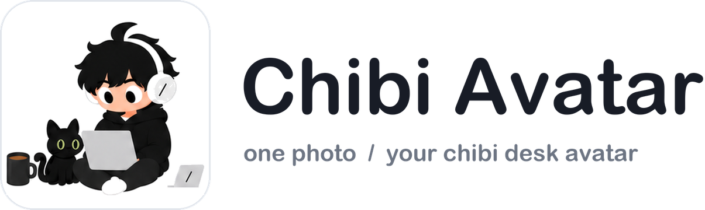
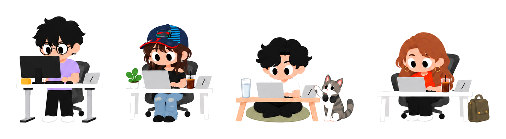

<div align="center">

<picture>
  <source media="(prefers-color-scheme: dark)" srcset="showcase/logo-dark.png">
  
</picture>

[English](README.md) · 简体中文

[](LICENSE)
[](https://creativecommons.org/licenses/by-nc/4.0/deed.zh-hans)
[](skills/chibi-avatar/SKILL.md)
[](#运行环境)



</div>

<!--
名人示例做好后，把图片放进 showcase/examples/，再取消下面这段注释，并按实际文件名修改。

## 示例

<div align="center">

|  |  |  |
|:---:|:---:|:---:|
| Sam Altman | Ray Dalio | Elon Musk |

<sub>非官方同人示例，与图中人物无关，也未经其背书。</sub>

</div>
-->

## 这是什么

Chibi Avatar 是一个给 AI 助手用的 skill。你上传一张人物照片，它就画出一个大头小身体、坐在桌前工作的 Q 版小人，并保留照片里的发型、肤色、眼镜和穿搭。

可以画你自己、你的同事，也可以画你喜欢的公众人物。

## 三步上手

**1. 下载**

```bash
git clone https://github.com/SlashVibeTeam/chibi-avatar.git
```

**2. 安装到 Codex**

```bash
mkdir -p ~/.codex/skills && cp -R chibi-avatar/skills/chibi-avatar ~/.codex/skills/
```

**3. 开一个新对话，上传照片，输入**

```
用 $chibi-avatar，按我的照片做一个 Q 版小人。
```

## 功能

| | |
|---|---|
| **一人一图** | 每次生成一张独立的方形小人图，约 1024 × 1024 |
| **保留特征** | 发型、发色、肤色、眼镜、配饰和穿搭都以照片为准 |
| **三种场景** | 居家木桌（默认）· 办公室工位 · 坐垫矮桌 |
| **可选加料** | 1–3 件桌面小物 · 宠物（另传一张宠物照片） · 透明背景 |
| **出图自检** | 按清单核对脸、手、桌面透视和比例，有问题只改局部 |

每张图的桌上都会有一台小小的 [SlashVibe](https://github.com/SlashVibeTeam) 产品，这是这套画风的固定元素。

## 更多用法

| 想要 | 这样说 |
|---|---|
| 指定特征 | `用 $chibi-avatar。保留黑框眼镜，居家办公，桌上放一只小咖啡杯。` |
| 带上宠物 | `用 $chibi-avatar，第一张是我，第二张是我的猫，让猫坐在桌边。` |
| 透明背景 | `用 $chibi-avatar，做办公桌前的全身小人，透明背景。` |
| 修改已有图 | `只把猫的眼睛改成黄绿色，其他保持不变。` |

更多写法见 [使用示例](skills/chibi-avatar/references/examples.md)。

## 运行环境

出图靠 AI 工具**自带的图像生成功能**，不需要额外的 API key。

| 工具 | 能否直接出图 |
|---|---|
| **Codex** | ✅ 可以，推荐 |
| 其他带内置生图功能、支持 skill 的 AI 工具 | ✅ 可以 |
| **Claude Code** | ⚠️ 不能。目前没有内置生图功能，只会给出整理好的 prompt 和参考图清单，需要再拿到其他生图工具里使用 |

<details>
<summary>在 Claude Code 中安装</summary>

```bash
mkdir -p ~/.claude/skills && cp -R chibi-avatar/skills/chibi-avatar ~/.claude/skills/
```

调用时把 `$chibi-avatar` 换成 `/chibi-avatar`。

</details>

<details>
<summary>只生成 prompt，不调用 AI 助手</summary>

仓库自带一个 prompt 整理脚本，只用 Python 标准库，不联网、不上传：

```bash
python3 skills/chibi-avatar/scripts/build_prompt.py --photo ~/me.jpg --scene home
```

输出的 prompt 和参考图路径可以直接用在支持参考图的生图工具里。`--scene` 可选 `home`、`office`、`floor`。

</details>

## 目录结构

```
skills/chibi-avatar/
├── SKILL.md            # skill 主说明
├── assets/             # 定稿参考图、产品外形和比例参考
├── references/         # 画风检查标准、使用示例
├── scripts/            # prompt 整理脚本
└── agents/             # Codex 界面配置
```

## 作者

画风与 skill 设计：**[Sherry](https://github.com/SherryLi8)** @ [SlashVibe](https://github.com/SlashVibeTeam)

## 免责声明

- 用本 skill 生成的公众人物形象（包括本仓库中的示例）均为非官方同人作品，与本人无关，也未经其背书。
- 请只使用你有权使用的照片。给别人做小人前，请先征得对方同意。

## 许可

- 代码与文字说明（`SKILL.md`、`references/`、`scripts/`、`agents/` 等）：[MIT](LICENSE)
- 图片（`assets/`、`showcase/`）：[CC BY-NC 4.0](https://creativecommons.org/licenses/by-nc/4.0/deed.zh-hans)，可以使用和改编，需署名，不可商用
